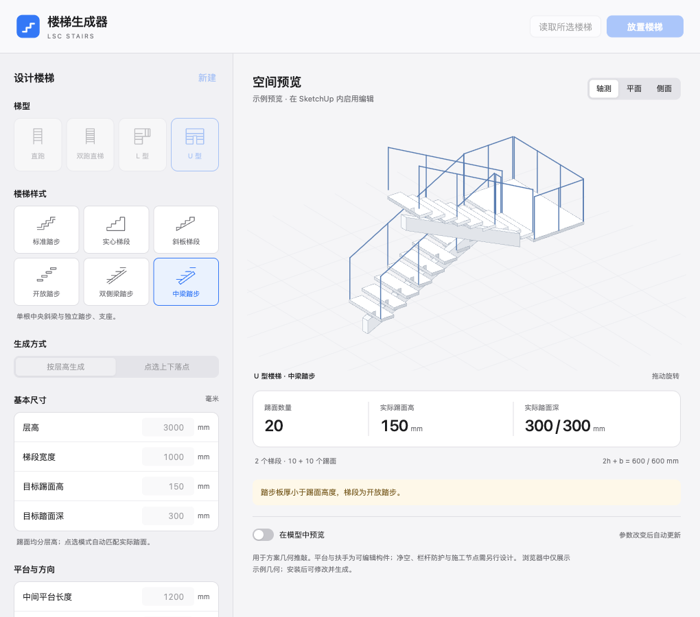

# LSC 楼梯生成器

独立、离线、可编辑的 SketchUp 参数楼梯插件。从 [空间推敲台](https://github.com/Lsc1123/sketchup-spatial-workbench) 的楼梯功能拆分，使用 MIT 许可开源。

**版本：0.2.0-beta.1。** 支持直跑、双跑直梯、L 型、U 型，六种几何样式，平台、扶手和立柱。界面参考苹果桌面应用的分组、控件和主次层级；所有几何在本机 Ruby 中计算，无在线依赖。



## 安装

从 [Releases](https://github.com/Lsc1123/sketchup-stair-generator/releases) 下载 `lsc-stairs-0.2.0-beta.1.rbz`，在 SketchUp 的“扩展程序管理器 → 安装扩展程序”中选择。菜单“扩展 → LSC 楼梯生成器”或工具栏可打开面板。

以 SketchUp 2021+ 为开发目标。当前自动测试覆盖纯 Ruby 几何与打包；macOS SU 2026 原生交互验收待完成，Windows 尚未验证。具体状态见 [验证记录](docs/validation.md)。测试版尚未经过 Extension Warehouse 签名，不会自动修改扩展加载策略。

## 使用

1. 选择梯型。按层高生成时，填写层高、梯宽、目标踢面高、踏面深和平台长度。
2. 选择楼梯样式，再调整转向、踏步板厚及两侧／单侧／关闭扶手；参数变化后自动刷新轴测、平面或侧面预览。轴测视图可以拖动旋转。
3. 点击“放置楼梯”，回到模型点击下方接入边缘。可勾选“在模型中预览”；Esc 取消。
4. 如需精确连接两个既有位置，选择“点选上下落点”，依次捕捉楼梯与下、上楼板的接入边缘，调整方向后点击“生成楼梯”。落点使用实际标高，水平坐标固定；直跑由两落点自动确定方向。
5. 选中本插件的顶层楼梯组件，点击“读取所选楼梯”或右键“编辑楼梯参数…”，修改后点击“更新所选楼梯”。

参数更新保留所选组件的位置、旋转、缩放、名称、标签和实例材质，并先独立化以保护复制件。更新会重建内部几何，覆盖内部手工修改；可通过 SketchUp 撤销恢复。无需参数更新时，可直接用原生工具编辑构件。

踏步按 **n 个踢面、n−1 个踏面** 计算，首末梯段直接接入原有楼板，**不额外生成起点／终点平台板及其栏杆**。双跑只在中间增加平台；U 型梯井宽度为两梯段之间的净距。“平台长度”只控制中间平台，直跑不显示此参数。点选模式的实际踏面可能与目标值不同，面板显示每段实际结果。点选位置是固定坐标快照，不随建筑面移动。

## 楼梯样式

| 样式 | 几何形态 | 预设尺寸 |
| --- | --- | --- |
| 标准踏步 | 连续台阶板，沿用第一版形态 | 板厚 180mm |
| 实心梯段 | 顶面为台阶，下方填实、底面水平 | 底部厚度 180mm |
| 斜板梯段 | 台阶顶面、连续倾斜底板 | 斜板最小竖向厚度 200mm |
| 开放踏步 | 独立薄踏步，保留踢面开口 | 板厚 60mm |
| 双侧梁踏步 | 两根矩形斜梁、薄踏步和支座 | 板厚 60mm，梁宽 100mm、梁高 240mm |
| 中梁踏步 | 一根中央矩形斜梁、薄踏步和支座 | 板厚 60mm，梁宽 160mm、梁高 280mm |

样式只设置几何参数，不预设或写入材质。切换样式保留层高、梯型、梯宽、踏面深、平台、转向与扶手设置；板厚和梁尺寸可继续自定义。梁高按竖向计。旧版组件读取后按标准踏步继续编辑。

宽度参数按踏步几何外缘计算，扶手向内布置；扶手高度以圆管中心线计。扶手提供圆管与立柱，梯段开口留空；“单侧”控制梯段侧边，转折平台仍在外露边界设栏杆。此版本用于方案几何推敲，不做建筑切割、净空碰撞或防护规范校核，也不含玻璃、栏板、螺旋梯或施工节点。

## 开发

运行环境仅使用 Ruby、Python 3 和 Node.js（语法检查）。插件运行不需要它们另行安装。

```sh
ruby tests/core_test.rb
ruby tests/styles_test.rb
ruby tests/controller_test.rb
ruby tools/check_syntax.rb
node --check src/lsc_stairs/ui/app.js
python3 tests/package_test.py
python3 tools/package.py
```

`dist/` 中生成可复现 RBZ、SHA256 与文件清单。`tools/package.py` 只打包明确列出的运行文件。修改核心后运行 `ruby tools/demo.rb` 更新浏览器示例；`src/lsc_stairs/ui/index.html` 可直接打开比较六种样式。示例由生产 Ruby 核心预先生成，其余尺寸只读，实际参数计算由 SketchUp 内 Ruby 完成。

```text
src/lsc_stairs.rb          扩展注册
src/lsc_stairs/core.rb     纯 Ruby 参数校验、求解和几何描述
src/lsc_stairs/geometry.rb SketchUp 实体与事务适配
src/lsc_stairs/tools.rb    放置、落点捕捉、模型预览
src/lsc_stairs/main.rb     面板回调与模型上下文
src/lsc_stairs/ui/         本地 HTML / CSS / JS
tests/                    几何、打包与专用原生测试
```

[开发与贡献](CONTRIBUTING.md) · [功能路线](docs/roadmap.md) · [代码来源与许可](docs/provenance.md) · [English](README.en.md)
